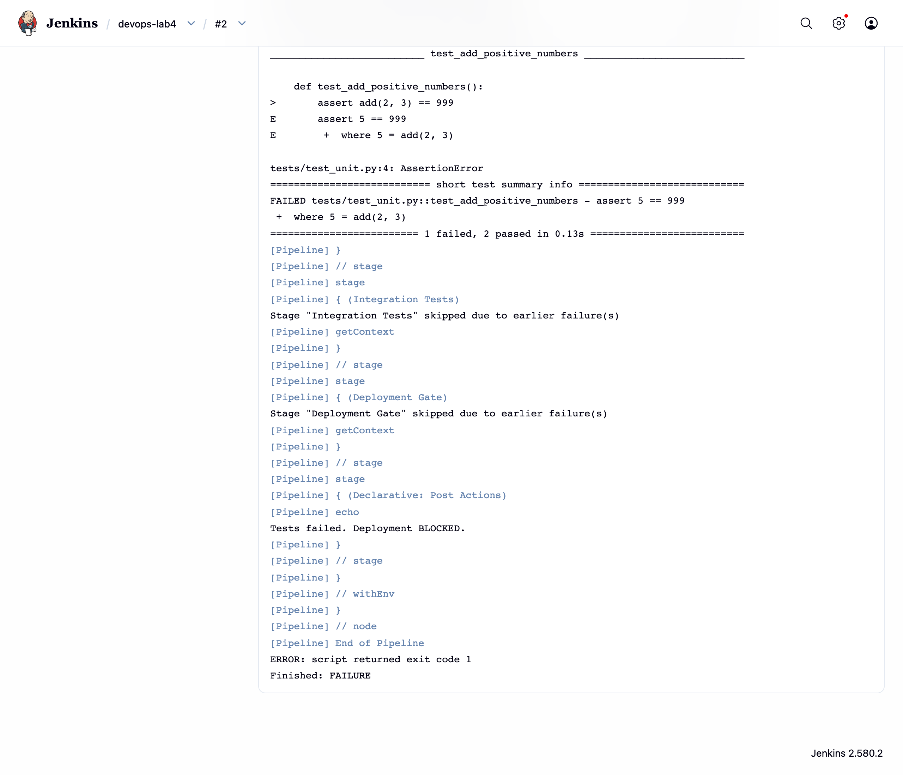

# Lab 4 - Advanced Deployment Strategies & Enterprise DevOps

**Course:** DevOps and Automation Lab (ENSP461)  
**Student:** Aditya Porwal | **GitHub:** `Adityaporwal18`  
**Environment:** Ubuntu 24.04.5 LTS virtual machine, Jenkins 2.580.2, Docker 29.10.1, Minikube v1.39.0 (Kubernetes v1.37.0), Argo CD v3.6.3. Lab run on 25 November 2026.

## Documentation

| Document | Contents |
|---|---|
| [Lab report](REPORT.md) | Q1-Q7: procedure, measured results, comparison of strategies |
| [Evidence gallery](docs/EVIDENCE.md) | Screenshots of every step with captions, plus links to the logs |
| [Commands executed](commands.txt) | The commands that were run, grouped by question |
| [Logs](docs/evidence/logs) | Terminal logs, Jenkins console logs and the failover request stream |

## Lab questions and results

| Question | Topic | Result |
|---|---|---|
| Q1 | Automated testing and deployment gates | Pass, deliberate fail (gate blocked), pass |
| Q2 | Blue-Green deployment | Switch and rollback under load, 0 failed requests |
| Q3 | Canary deployment and rollback | Measured 90/10, 70/30 and 100/0 over 100 requests each |
| Q4 | GitOps using Argo CD | Git change synced automatically; manual drift self-healed in 9 s |
| Q5 | Secure secret management | Jenkins credential masked in the log; Kubernetes Secret injected into a Pod |
| Q6 | Disaster recovery and failover | Restore in 379 ms with matching checksum; failover outage 7.3 s |
| Q7 | Report | [REPORT.md](REPORT.md) |



## Run the tests

```bash
python3 -m venv .venv
.venv/bin/python -m pip install -r requirements.txt
.venv/bin/python -m pytest -v
```

## Blue-Green deployment

```bash
docker compose -f bluegreen/compose.yaml up -d --build
curl http://localhost:8086/
scripts/switch-bluegreen.sh green
scripts/count-versions.sh http://localhost:8086/ 50
```

## Canary deployment

```bash
docker compose -f canary/compose.yaml up -d --build
scripts/count-versions.sh http://localhost:8087/ 100
scripts/set-canary-weights.sh 7 3
scripts/set-canary-weights.sh 1 0
```

## GitOps

```bash
kubectl apply -f gitops/application.yaml
```

Argo CD then keeps the cluster in line with `gitops/manifests/` on the `main` branch.

## Main files

```text
app.py                      Flask application (version from APP_VERSION)
tests/                      Unit and integration tests (pytest)
Jenkinsfile                 Secret stage, tests and deployment gate
jenkins/job-config.xml      Jenkins job definition
bluegreen/                  Compose file and nginx configuration for Blue-Green
canary/                     Compose file and nginx configuration for Canary
gitops/application.yaml     Argo CD application
gitops/manifests/           Deployment and Service managed by Argo CD
secrets/secret-demo-pod.yaml  Pod that reads a Kubernetes Secret
disaster-recovery/          PVC, Pod and recovery targets
scripts/                    Switch, canary, measurement, failover and restore scripts
commands.txt                Commands executed in the lab
REPORT.md                   Lab report
docs/EVIDENCE.md            Evidence gallery
```
