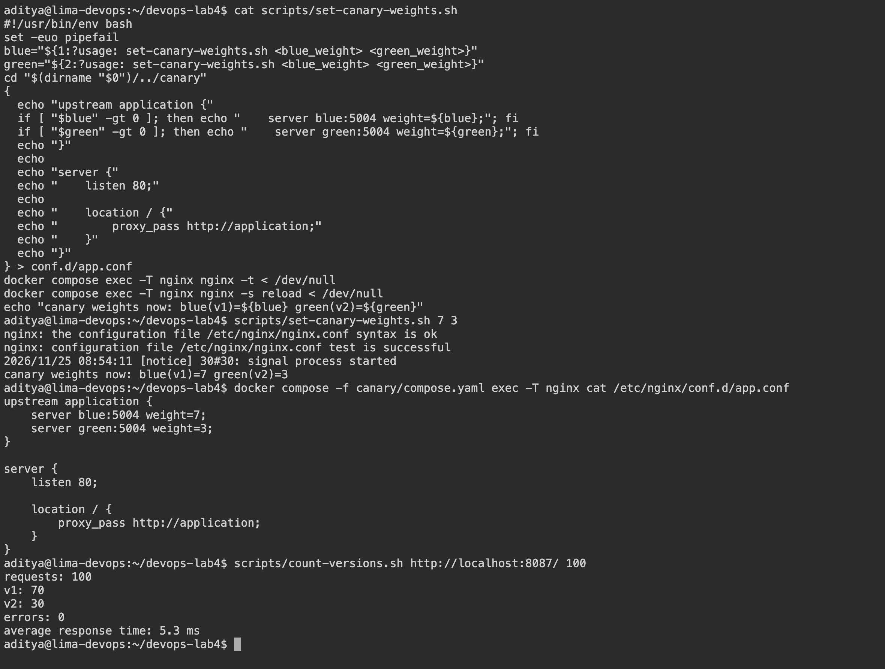
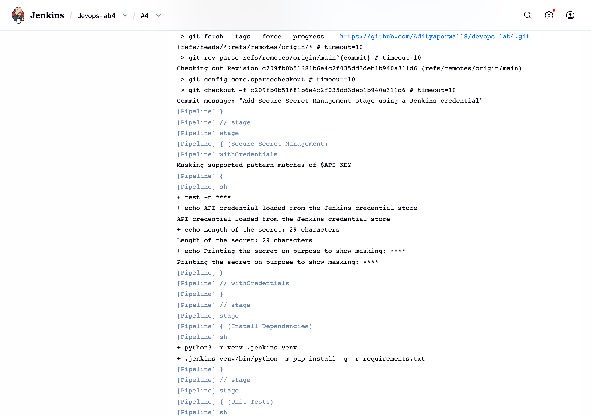
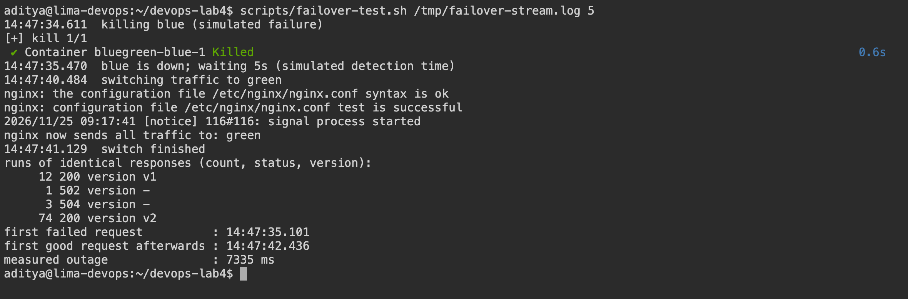
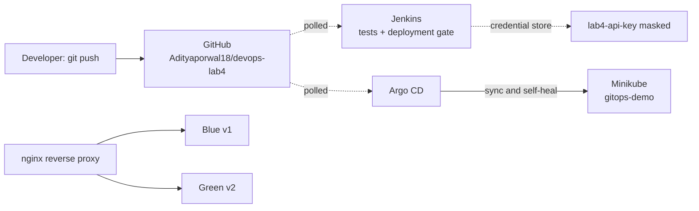

# Lab 4 Report - Advanced Deployment Strategies & Enterprise DevOps

**Course:** DevOps and Automation Lab (ENSP461)  
**Student:** Aditya Porwal  
**Repository:** https://github.com/Adityaporwal18/devops-lab4  
**Environment:** Ubuntu 24.04.5 LTS virtual machine (Lima 2.3.0) on a MacBook Pro (Apple M1, macOS 26.4)  
**Date of this run:** 25 November 2026

[Repository overview](README.md) | [Evidence gallery](docs/EVIDENCE.md) | [Commands executed](commands.txt)

## 1. Objective

To implement and evaluate advanced DevOps practices: automated test gates in a CI/CD pipeline, Blue-Green and Canary deployments, GitOps reconciliation with Argo CD, secure secret management, and disaster recovery with a measured failover.

## 2. Environment and tools

| Component | Observed value |
|---|---|
| Operating system | Ubuntu 24.04.5 LTS, aarch64 (virtual machine with 4 CPUs and 4 GiB RAM) |
| Jenkins | 2.580.2, job `devops-lab4` (Pipeline script from SCM, `pollSCM` trigger) |
| Python / pytest | Python 3.12.3, pytest 9.2.0 (tests); `python:3.14-slim` (application image) |
| Docker / Compose | 29.10.1 / v5.8.0 |
| Reverse proxy | `nginx:alpine` |
| Kubernetes | Minikube v1.39.0, Kubernetes v1.37.0, single node |
| Argo CD | v3.6.3 |

## 3. Application

[app.py](app.py) is a small Flask application. `/` returns JSON with the application name, a `version` taken from the `APP_VERSION` environment variable and a status; `/health` returns `{"status":"healthy"}`. The same image is started twice with different `APP_VERSION` values: **Blue = v1** and **Green = v2**.

## Q1 - Automated testing and deployment gates

**Pipeline.** The [Jenkinsfile](Jenkinsfile) runs Checkout, Install Dependencies, Unit Tests (3 tests), Integration Tests (3 tests) and a Deployment Gate. A declarative pipeline stops at the first failed stage, so the gate only runs when both test stages pass.

**Results.**

| Build | Time | Cause | Revision | Tests | Gate | Result |
|---|---|---|---|---|---|---|
| #1 | 14:10:57 | Started by user Aditya Porwal | `45552cb` | 3 + 3 passed | Approved | SUCCESS |
| #2 | 14:13:08 | SCM change (deliberate failing assertion) | `3feba7a` | 1 failed, 2 passed | Skipped - **blocked** | FAILURE |
| #3 | 14:15:08 | SCM change (assertion restored) | `177c2eb` | 3 + 3 passed | Approved | SUCCESS |

In build #2 the assertion `add(2, 3) == 999` fails. Jenkins reports the stages *Integration Tests* and *Deployment Gate* as "skipped due to earlier failure(s)" and prints `Tests failed. Deployment BLOCKED.`

**Scope.** The Deployment Gate prints an approval message; it does not deploy anything itself. The integration tests call the application through Flask's in-process test client, not over the network.

Evidence: [Q1 in the gallery](docs/EVIDENCE.md#q1---automated-testing-and-deployment-gates)

## Q2 - Blue-Green deployment

**Setup.** [bluegreen/compose.yaml](bluegreen/compose.yaml) starts Blue (v1), Green (v2) and nginx on `127.0.0.1:8086`. The upstream in [bluegreen/conf.d/app.conf](bluegreen/conf.d/app.conf) names the live environment. [scripts/switch-bluegreen.sh](scripts/switch-bluegreen.sh) changes that line, runs `nginx -t` and reloads nginx.

**Test method.** [scripts/request-stream.sh](scripts/request-stream.sh) sends one request every 0.25 s and prints the time, HTTP status and version of each response. The switch is run in the background while the stream is running, so the stream crosses the switch.

| Test | Requests before the switch | Requests after the switch | Failed requests |
|---|---|---|---|
| Blue to Green | 1-9: `v1` | 10-28: `v2` | 0 of 28 |
| Rollback, Green to Blue | 1-8: `v2` | 9-28: `v1` | 0 of 28 |

After each switch 50 of 50 further requests returned the new version, and the configuration was read back from inside the running nginx container.

**A problem that occurred.** The first switch attempt changed the configuration file, but the endpoint kept serving `v1`. `jobs -l` showed the background job as *Stopped (tty input)*: `docker compose exec` tried to read from the terminal, so the shell suspended the script before `nginx -s reload` ran. Redirecting standard input (`< /dev/null`) fixed it. A changed file is therefore not proof of a switch; the responses have to be measured.

**Advantages:** instant switch and instant rollback, and the new version can be checked before it receives traffic.  
**Limitations:** two complete environments are needed, and database changes must be compatible with both versions.

Evidence: [Q2 in the gallery](docs/EVIDENCE.md#q2---blue-green-deployment)

## Q3 - Canary deployment and rollback

**Setup.** [canary/compose.yaml](canary/compose.yaml) uses weighted nginx upstreams. [scripts/set-canary-weights.sh](scripts/set-canary-weights.sh) writes the weights, tests and reloads nginx. [scripts/count-versions.sh](scripts/count-versions.sh) sends 100 requests and counts versions, errors and the average response time.

| Step | Weights (v1 : v2) | Measured over 100 requests | Errors | Average response time |
|---|---|---|---|---|
| Initial canary | 9 : 1 | v1: 90, v2: 10 | 0 | 4.5 ms |
| Increased exposure | 7 : 3 | v1: 70, v2: 30 | 0 | 5.3 ms |
| Rollback | 1 : 0 | v1: 100, v2: 0 | 0 | 8.5 ms |

The counts match the weights exactly because nginx's weighted round-robin is deterministic. The response times are from single runs on a shared VM and are too close to each other to compare the versions.

**Advantages:** only part of the traffic sees the new version, so a bad release affects fewer requests.  
**Limitations:** it needs traffic control, monitoring and clear criteria for continuing or rolling back.

Evidence: [Q3 in the gallery](docs/EVIDENCE.md#q3---canary-deployment-and-rollback)

## Q4 - GitOps using Argo CD

**Setup.** Argo CD v3.6.3 was installed on the Minikube cluster. The application is defined declaratively in [gitops/application.yaml](gitops/application.yaml): repository `Adityaporwal18/devops-lab4`, revision `main`, path `gitops/manifests`, automated sync with `prune` and `selfHeal`.

**Results.**

| Step | What happened | Evidence |
|---|---|---|
| First sync | Argo CD created the Deployment (2/2), two pods and the Service from Git | [E39](docs/evidence/screenshots/39-gitops-initial-two-replicas.png) |
| Change through Git | `replicas: 2` changed to `3`, commit `de1a448` pushed at 14:40:43. Argo CD synced it at 14:42:52 and the Deployment reached 3/3 | [E43](docs/evidence/screenshots/43-gitops-argocd-synced-three-replicas.png) |
| Manual drift | `kubectl scale --replicas=1` at 14:44:04. Without any further command the Deployment was back at 3/3 at 14:44:13 | [E45](docs/evidence/screenshots/45-gitops-self-heal-after-manual-drift.png) |

The Deployment's events show all four changes in order: 0 to 2, 2 to 3, 3 to 1 and 1 to 3.

**Observation.** The Git change took about two minutes to arrive because Argo CD polls the repository at an interval. The manual drift was corrected in about nine seconds because Argo CD watches the cluster continuously.

Evidence: [Q4 in the gallery](docs/EVIDENCE.md#q4---gitops-using-argo-cd)

## Q5 - Secure secret management

**Jenkins credentials.** A *Secret text* credential `lab4-api-key` is stored in Jenkins. The pipeline stage **Secure Secret Management** loads it with `withCredentials` and deliberately tries to print it. The console shows `Masking supported pattern matches of $API_KEY` and prints `****` instead of the value (build #4).

**Kubernetes Secrets.** A Secret `lab4-app-secret` is created from a random value generated on the command line, so the value is never typed or stored in a file. The Pod in [secrets/secret-demo-pod.yaml](secrets/secret-demo-pod.yaml) reads it through `secretKeyRef` and logs `Kubernetes Secret injected successfully`. `kubectl describe secret` shows only the key name and size.

**Security notes.**

- No secret value is stored in this repository, in the screenshots or in the logs. Both secrets are random demo values.
- Jenkins masks exact matches only. A transformed secret (for example base64-encoded) would not be masked, so pipelines should never print secrets at all.
- Kubernetes Secrets are base64-encoded, not encrypted, unless encryption at rest is configured. Access must be limited with RBAC, and production systems should use an external secret manager and rotate secrets.

Evidence: [Q5 in the gallery](docs/EVIDENCE.md#q5---secure-secret-management)

## Q6 - Disaster recovery and failover

**Targets.** The targets in [disaster-recovery/TARGETS.md](disaster-recovery/TARGETS.md) were committed before the tests were run.

| Objective | Target | Measured | Met |
|---|---|---|---|
| RTO - data restore | 30 s | 379 ms | Yes |
| RPO - data | No loss of data written before the latest backup | Restored file has the same SHA-256 as the backup | Yes |
| RTO - service failover | 60 s | 7.3 s of failed requests | Yes |

**Data recovery.** A PersistentVolumeClaim holds a test record. The file was backed up with `kubectl cp`, deleted, and restored by [scripts/restore-data.sh](scripts/restore-data.sh), which times the restore in milliseconds and compares checksums. The record also survived deleting and recreating the Pod.

**Failover.** [scripts/failover-test.sh](scripts/failover-test.sh) starts a request stream, kills Blue, waits 5 seconds as a simulated detection time and switches nginx to Green.

| Time | Event |
|---|---|
| 14:47:34.6 | Blue is killed |
| 14:47:35.1 | First failed request (HTTP 502), followed by three HTTP 504 |
| 14:47:40.5 | Traffic is switched to Green |
| 14:47:42.4 | First good request again (`v2`) |

Of 90 requests, 12 returned `v1`, 4 failed and 74 returned `v2`. The measured outage is **7335 ms**.

**Limits of this test.** The failover is started by a script, not by automatic health checks, and the 5-second detection time is an assumption. The outage is about two seconds longer than the detection time because requests already sent to the dead container had to time out. The RPO result holds because the backup was taken right after the data was written; with scheduled backups the RPO equals the backup interval.

Evidence: [Q6 in the gallery](docs/EVIDENCE.md#q6---disaster-recovery-and-failover)

## Q7 - Comparison of deployment strategies

| Strategy | What was measured in this lab | Main benefit | Main risk | Suitable use |
|---|---|---|---|---|
| Test gate | A failing test stopped the pipeline before the gate | Faulty code does not reach deployment | Only as good as the tests | Every pipeline |
| Blue-Green | Switch and rollback with 0 failed requests of 28 | Fast switch and rollback | Cost of a second environment | Major releases |
| Canary | 90/10, 70/30 and full rollback, 0 errors in 300 requests | Limited exposure of a new version | Needs monitoring and routing control | Risk-sensitive releases |
| GitOps | Git change applied in about 2 minutes, drift corrected in 9 seconds | Declarative, auditable, self-healing | Git and cluster access must be protected | Kubernetes platforms |
| Failover | 7.3 s outage with a scripted switch | Service continues on the standby | Manual detection is slow | High-availability services |

### Architecture

### Jenkins builds during the lab

| Build | Trigger | Revision | Result |
|---|---|---|---|
| #1 | Manual | `45552cb` | SUCCESS |
| #2 | SCM change | `3feba7a` | FAILURE (deliberate) |
| #3 | SCM change | `177c2eb` | SUCCESS |
| #4 | SCM change | `c209fb0` | SUCCESS (secret stage added) |
| #5 | SCM change | `de1a448` | SUCCESS |
| #6 | SCM change | `51515d9` | SUCCESS |

Later documentation pushes are tested automatically in the same way.

## Conclusion

Each practice was implemented and checked with a measurement instead of only a successful command. The pipeline gate blocked a faulty commit. Blue-Green switching and rollback completed without a failed request. Canary traffic followed the configured weights and was rolled back completely. Argo CD applied a Git change and reversed a manual change. Secrets were used in Jenkins and Kubernetes without being exposed. Data was restored with a matching checksum and a failover completed within the target time. The environment is a single local VM, so the results show that the mechanisms work; they are not production performance figures.
