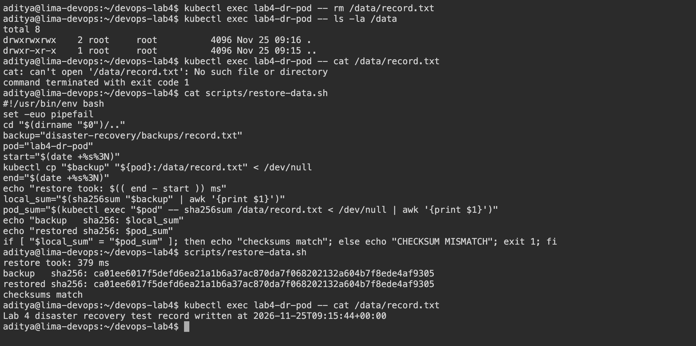
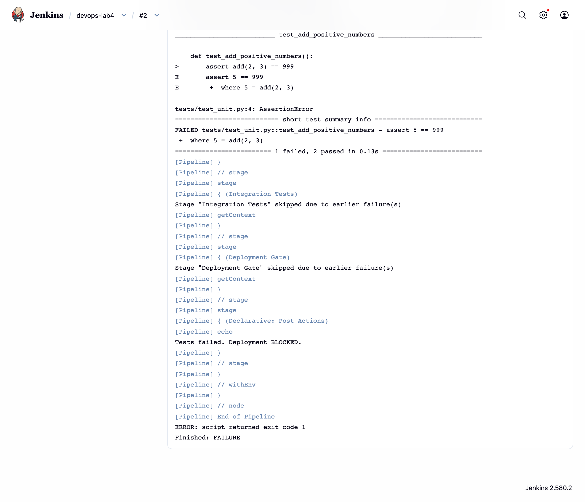
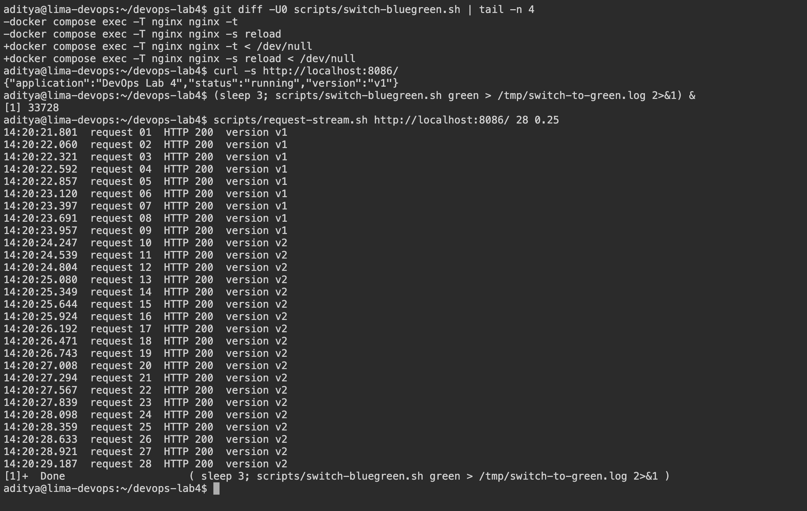
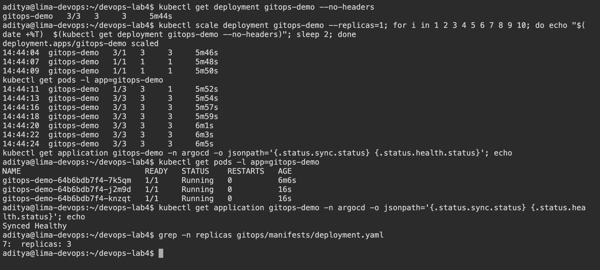
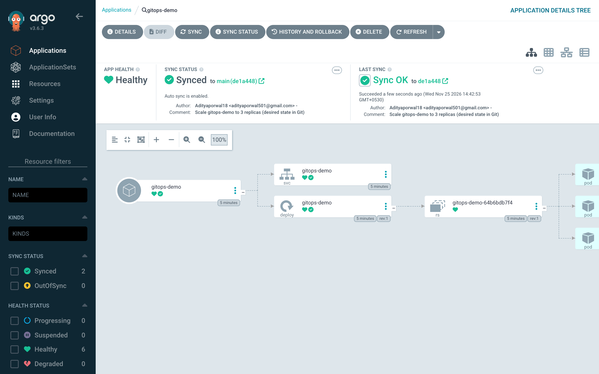
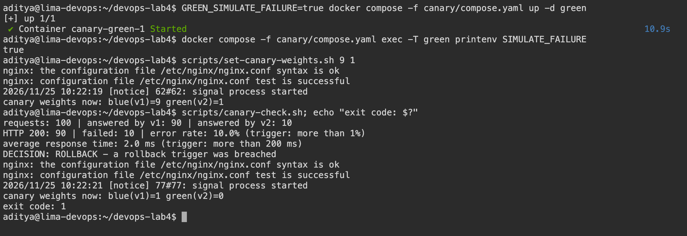
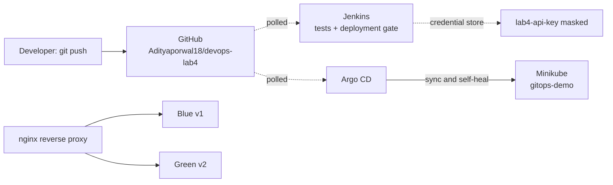

# Lab 4 Report - Advanced Deployment Strategies & Enterprise DevOps

**Course:** DevOps and Automation Lab (ENSP461)  
**Student:** Aditya Porwal  
**Repository:** https://github.com/Adityaporwal18/devops-lab4  
**Environment:** Ubuntu 24.04.5 LTS virtual machine (Lima 2.3.0) on a MacBook Pro (Apple M1, macOS 26.4)  
**Date of this run:** 25 November 2026

[Repository overview](README.md) | [Evidence gallery](docs/EVIDENCE.md) | [Commands executed](commands.txt)

Question numbers follow the assignment portal. Q5, the comparison report, is placed after Q7 because it builds on the results of the other questions.

## 1. Objective

To implement and evaluate advanced DevOps practices: a disaster recovery mechanism, automated test gates in a CI/CD pipeline, Blue-Green and Canary deployments, GitOps reconciliation with Argo CD and secure secret management, and to compare them with a risk analysis.

## 2. Environment and tools

| Component | Observed value |
|---|---|
| Operating system | Ubuntu 24.04.5 LTS, aarch64 (virtual machine with 4 CPUs and 4 GiB RAM) |
| Jenkins | 2.580.2, job `devops-lab4` (Pipeline script from SCM, `pollSCM` trigger) |
| Python / pytest | Python 3.12.3, pytest 9.2.0 (tests); `python:3.14-slim` (application image) |
| Docker / Compose | 29.10.1 / v5.8.0 |
| Reverse proxy | `nginx:alpine` |
| Kubernetes | Minikube v1.39.0, Kubernetes v1.37.0, single node |
| Argo CD | v3.6.3 |

## 3. Application

[app.py](app.py) is a small Flask application. `/` returns JSON with the application name, a `version` taken from the `APP_VERSION` environment variable and a status; `/health` returns `{"status":"healthy"}`. The same image is started twice with different `APP_VERSION` values: **Blue = v1** and **Green = v2**. For the canary trigger test the application has a fault switch: with `SIMULATE_FAILURE=true` the page returns HTTP 500. The switch is off by default.

## Q1 - Disaster recovery and failover

**Design.**

| Part | Mechanism | Files |
|---|---|---|
| Backup | The data file on a Kubernetes persistent volume is copied out with `kubectl cp` and its SHA-256 checksum is recorded | [disaster-recovery/pvc.yaml](disaster-recovery/pvc.yaml), [disaster-recovery/pod.yaml](disaster-recovery/pod.yaml) |
| Restore | [scripts/restore-data.sh](scripts/restore-data.sh) copies the backup back, times the restore in milliseconds and compares checksums | |
| Failover | A second environment (Green) runs next to the live one (Blue). If Blue fails, nginx is switched to Green by [scripts/failover-test.sh](scripts/failover-test.sh) | [bluegreen/compose.yaml](bluegreen/compose.yaml) |

**Recovery objectives.** The targets in [disaster-recovery/TARGETS.md](disaster-recovery/TARGETS.md) were committed before the tests were run.

| Objective | Target | Measured | Met |
|---|---|---|---|
| RTO - data restore | 30 s | 379 ms | Yes |
| RPO - data | No loss of data written before the latest backup | Restored file has the same SHA-256 as the backup | Yes |
| RTO - service failover | 60 s | 7.3 s of failed requests | Yes |

RTO (Recovery Time Objective) is the longest acceptable time to restore service. RPO (Recovery Point Objective) is the largest acceptable data loss, expressed as time since the last good backup.

**Backup and restore.** A test record was written to the volume and backed up; original and backup had the same checksum. The file was then deleted (`No such file or directory`) and restored by the script in 379 ms with a matching checksum. The record also survived deleting and recreating the Pod, because the data lives on the persistent volume.

**Failover.** The test starts a request stream (one request every 0.25 s), kills Blue, waits 5 seconds as a simulated detection time and switches nginx to Green.

| Time | Event |
|---|---|
| 14:47:34.6 | Blue is killed |
| 14:47:35.1 | First failed request (HTTP 502), followed by three HTTP 504 |
| 14:47:40.5 | Traffic is switched to Green |
| 14:47:42.4 | First good request again (`v2`) |

Of 90 requests, 12 returned `v1`, 4 failed and 74 returned `v2`. The measured outage is **7335 ms**. Blue was then started again and kept as the standby.

**Observations and limits.**

- The outage is about two seconds longer than the detection time, because requests already sent to the dead container had to time out.
- The failover is started by a script, not by automatic health checks, and the 5-second detection time is an assumption. A person noticing the failure would take longer.
- The RPO result holds because the backup was taken right after the data was written. With scheduled backups the RPO equals the backup interval.
- The backup is stored on the same machine as the cluster. That protects against deleted data, not against losing the machine.

Evidence: [Q1 in the gallery](docs/EVIDENCE.md#q1---disaster-recovery-and-failover)

## Q2 - Automated testing and deployment gates

**Pipeline.** The [Jenkinsfile](Jenkinsfile) runs Checkout, Install Dependencies, Unit Tests (3 tests), Integration Tests (3 tests) and a Deployment Gate. A declarative pipeline stops at the first failed stage, so the gate only runs when both test stages pass.

**Results.**

| Build | Time | Cause | Revision | Tests | Gate | Result |
|---|---|---|---|---|---|---|
| #1 | 14:10:57 | Started by user Aditya Porwal | `45552cb` | 3 + 3 passed | Approved | SUCCESS |
| #2 | 14:13:08 | SCM change (deliberate failing assertion) | `3feba7a` | 1 failed, 2 passed | Skipped - **blocked** | FAILURE |
| #3 | 14:15:08 | SCM change (assertion restored) | `177c2eb` | 3 + 3 passed | Approved | SUCCESS |

In build #2 the assertion `add(2, 3) == 999` fails. Jenkins reports the stages *Integration Tests* and *Deployment Gate* as "skipped due to earlier failure(s)" and prints `Tests failed. Deployment BLOCKED.`

**Scope.** The Deployment Gate prints an approval message; it does not deploy anything itself. The integration tests call the application through Flask's in-process test client, not over the network.

Evidence: [Q2 in the gallery](docs/EVIDENCE.md#q2---automated-testing-and-deployment-gates)

## Q3 - Blue-Green deployment

**Setup.** [bluegreen/compose.yaml](bluegreen/compose.yaml) starts Blue (v1), Green (v2) and nginx on `127.0.0.1:8086`. The upstream in [bluegreen/conf.d/app.conf](bluegreen/conf.d/app.conf) names the live environment. [scripts/switch-bluegreen.sh](scripts/switch-bluegreen.sh) changes that line, runs `nginx -t` and reloads nginx.

**Zero-downtime test.** [scripts/request-stream.sh](scripts/request-stream.sh) sends one request every 0.25 s and prints the time, HTTP status and version of each response. The switch runs in the background while the stream is running, so the stream crosses the switch.

| Test | Requests before the switch | Requests after the switch | Failed requests |
|---|---|---|---|
| Blue to Green | 1-9: `v1` | 10-28: `v2` | 0 of 28 |
| Rollback, Green to Blue | 1-8: `v2` | 9-28: `v1` | 0 of 28 |

After each switch 50 of 50 further requests returned the new version, and the configuration was read back from inside the running nginx container.

**A problem that occurred.** The first switch attempt changed the configuration file, but the endpoint kept serving `v1`. `jobs -l` showed the background job as *Stopped (tty input)*: `docker compose exec` tried to read from the terminal, so the shell suspended the script before `nginx -s reload` ran. Redirecting standard input (`< /dev/null`) fixed it. A changed file is therefore not proof of a switch; the responses have to be measured.

**Advantages.**

- The switch and the rollback are one configuration change and took effect between two requests.
- Green can be tested while Blue still serves all users.
- The old version stays running, so rollback needs no rebuild or redeploy.

**Limitations.**

- Two complete environments must run at the same time, which doubles the resources.
- All users move at once, so a fault in the new version affects everyone until rollback.
- Database or data-format changes must work with both versions. This lab's application has no database, so that was not tested.
- "Zero downtime" was shown for short, stateless requests. Long-running connections were not tested.

Evidence: [Q3 in the gallery](docs/EVIDENCE.md#q3---blue-green-deployment)

## Q4 - GitOps using Argo CD

**Setup.** Argo CD v3.6.3 was installed on the Minikube cluster. The application is defined declaratively in [gitops/application.yaml](gitops/application.yaml): repository `Adityaporwal18/devops-lab4`, revision `main`, path `gitops/manifests`, automated sync with `prune` and `selfHeal`. Git is the single source of truth: the Deployment was never changed with `kubectl`, except once on purpose to test drift.

**Results.**

| Step | What happened | Evidence |
|---|---|---|
| First sync | Argo CD created the Deployment (2/2), two pods and the Service from Git | [screenshot](docs/evidence/screenshots/39-gitops-initial-two-replicas.png) |
| Change through Git | `replicas: 2` changed to `3`, commit `de1a448` pushed at 14:40:43. Argo CD synced it at 14:42:52 and the Deployment reached 3/3 | [screenshot](docs/evidence/screenshots/43-gitops-argocd-synced-three-replicas.png) |
| Manual drift | `kubectl scale --replicas=1` at 14:44:04. Without any further command the Deployment was back at 3/3 at 14:44:13 | [screenshot](docs/evidence/screenshots/45-gitops-self-heal-after-manual-drift.png) |

The Deployment's events show all four changes in order: 0 to 2, 2 to 3, 3 to 1 and 1 to 3.

**Observation.** The Git change took about two minutes to arrive because Argo CD polls the repository at an interval. The manual drift was corrected in about nine seconds because Argo CD watches the cluster continuously.

Evidence: [Q4 in the gallery](docs/EVIDENCE.md#q4---gitops-using-argo-cd)

## Q6 - Secure secret management

**Secret stores used.** The pipeline uses the **Jenkins credential store** and the deployment uses **Kubernetes Secrets**. A separate vault product such as HashiCorp Vault was not used.

**Pipeline: Jenkins credentials.** A *Secret text* credential `lab4-api-key` is stored in Jenkins. The pipeline stage **Secure Secret Management** loads it with `withCredentials` and deliberately tries to print it. The console shows `Masking supported pattern matches of $API_KEY` and prints `****` instead of the value (build #4).

**Deployment: Kubernetes Secrets.** A Secret `lab4-app-secret` is created from a random value generated on the command line, so the value is never typed or stored in a file. The Pod in [secrets/secret-demo-pod.yaml](secrets/secret-demo-pod.yaml) reads it through `secretKeyRef` and logs `Kubernetes Secret injected successfully`. `kubectl describe secret` shows only the key name and size.

**Safe handling.**

| Practice | How it was applied |
|---|---|
| No secrets in Git | No secret value is in the repository, the screenshots or the logs; `.env` files are ignored by Git |
| No secrets in logs | Jenkins masked the value; the Kubernetes demo prints only the length |
| Demo values only | Both secrets are random strings generated for this lab |

**Security notes.**

- Jenkins masks exact matches only. A transformed secret (for example base64-encoded) would not be masked, so pipelines should never print secrets at all.
- Kubernetes Secrets are base64-encoded, not encrypted, unless encryption at rest is configured. Access must be limited with RBAC.
- Production systems should use an external secret manager with access control, audit logs and rotation.

Evidence: [Q6 in the gallery](docs/EVIDENCE.md#q6---secure-secret-management)

## Q7 - Canary deployment, rollout metrics and rollback triggers

**Setup.** [canary/compose.yaml](canary/compose.yaml) uses weighted nginx upstreams, so a fixed share of requests goes to the new version. [scripts/set-canary-weights.sh](scripts/set-canary-weights.sh) writes the weights, tests and reloads nginx.

**Gradual rollout.** [scripts/count-versions.sh](scripts/count-versions.sh) sends 100 requests and counts versions, errors and the average response time.

| Step | Weights (v1 : v2) | Measured over 100 requests | Errors | Average response time |
|---|---|---|---|---|
| Initial canary | 9 : 1 | v1: 90, v2: 10 | 0 | 4.5 ms |
| Increased exposure | 7 : 3 | v1: 70, v2: 30 | 0 | 5.3 ms |
| Manual rollback | 1 : 0 | v1: 100, v2: 0 | 0 | 8.5 ms |

**Rollback triggers.** The triggers in [canary/ROLLBACK-TRIGGERS.md](canary/ROLLBACK-TRIGGERS.md) were committed before the trigger test. [scripts/canary-check.sh](scripts/canary-check.sh) measures 100 requests and rolls back by itself if a trigger is breached.

| Metric | Rollback trigger |
|---|---|
| Error rate (responses that are not HTTP 200) | more than 1% |
| Average response time | more than 200 ms |

**Trigger test.**

| Step | v1 / v2 | Error rate | Average response time | Decision |
|---|---|---|---|---|
| Healthy v2 at 10% | 90 / 10 | 0.0% | 2.4 ms | CONTINUE |
| Healthy v2 at 30% | 70 / 30 | 0.0% | 2.4 ms | CONTINUE |
| Faulty v2 at 10% | 90 / 10 | **10.0%** (10 failed) | 2.0 ms | **ROLLBACK**, done by the script |
| After the rollback | 100 / 0 | 0.0% | 1.8 ms | CONTINUE |

**Analysis of the metrics.**

- The measured split matched the weights exactly (90/10, 70/30), because nginx's weighted round-robin is deterministic.
- With the canary at 10%, the faulty release failed 10 of 100 requests. A full release of the same version would have failed all of them.
- The error-rate trigger caught the fault. The response-time trigger did not, because the failing responses were fast (2.0 ms). One metric alone is not enough.
- The response times of healthy runs (1.8 to 8.5 ms) are single runs on a shared VM and are too close to compare the versions.

**Limits.**

- The fault was simulated with a switch in the application.
- The "subset of users" is a share of requests. The same user can reach either version on different requests; real canaries often pin a user to one version.
- The check was run by hand after each step. In production it would run continuously.
- A sample of 100 requests cannot detect an error rate much below 1%.

Evidence: [Q7 in the gallery](docs/EVIDENCE.md#q7---canary-deployment-rollout-metrics-and-rollback-triggers)

## Q5 - Advanced deployment strategies report

This section compares the approaches using the results above.

### Comparison

| Approach | What was measured in this lab | Main benefit | Main risk | Suitable use |
|---|---|---|---|---|
| Blue-Green | Switch and rollback with 0 failed requests of 28 each | Instant switch and rollback | A fault reaches all users at once; cost of a second environment | Major releases that were fully tested beforehand |
| Canary | 90/10 and 70/30 with 0 errors; a faulty release failed 10% of requests and was rolled back by a trigger | Only part of the traffic is exposed to a new version | Needs good metrics and triggers; a wrong trigger misses faults | Risk-sensitive releases with enough traffic to measure |
| GitOps | Git change applied in about 2 minutes; manual drift corrected in 9 seconds | Declarative, auditable, self-healing | Whoever can push to Git can change the cluster; urgent manual fixes are overwritten | Kubernetes platforms with several people or teams |
| Secret management | Jenkins masked a printed secret; a Kubernetes Secret was injected without appearing in Git or logs | Credentials stay out of code and logs | Masking is exact-match only; Kubernetes Secrets are only base64-encoded by default | Every pipeline and deployment |
| Disaster recovery | Restore in 379 ms with matching checksum; failover outage 7.3 s | Data and service can be brought back | Backups on the same machine; manual detection is slow | Any service with data or availability requirements |

Blue-Green and Canary are ways to release a version. GitOps is a way to deliver and keep the declared state. Secret management and disaster recovery are needed with any of them. They complement each other and are not alternatives.

### Risk analysis

| Risk | Where it appeared in this lab | Impact | Mitigation |
|---|---|---|---|
| A switch looks done but did not take effect | First Blue-Green attempt: the file was changed, nginx was not reloaded | Operators believe the new version is live while users still get the old one | Verify by measuring responses and reading the running proxy's configuration; the script was fixed |
| A faulty version reaches users | Canary trigger test: 10 of 100 requests failed before the rollback | Errors for the exposed share of users | Start with a small share, check metrics after every step, roll back automatically |
| A trigger misses the fault | The response-time trigger did not fire for fast HTTP 500 responses | A broken release continues to roll out | Use several triggers (errors, latency, business checks) |
| Faulty code passes the gate | The gate only knows the six tests; integration tests run in-process | Bugs outside the tests reach deployment | More tests, tests against a running instance, code review |
| Manual changes to the cluster | `kubectl scale` was undone by Argo CD in 9 seconds | Drift, or loss of an urgent manual fix | Make all changes through Git; restrict cluster and repository access |
| Secret exposure | The pipeline printed the secret on purpose and Jenkins masked it | Leaked credentials | Never print secrets; restrict access; use encryption at rest, an external secret manager and rotation |
| Data loss | The data file was deleted and restored from a backup | Loss of everything since the last backup | Scheduled backups, checksums, backups stored on another machine |
| Long outage on failure | 7.3 s of failed requests with a scripted switch and an assumed detection time | Service unavailable | Automatic health checks and failover |
| Single machine | Everything ran on one VM and a single-node cluster | One failure stops everything | Several nodes or sites in a real deployment |

### Architecture

### Jenkins builds during the lab

| Build | Trigger | Revision | Result |
|---|---|---|---|
| #1 | Manual | `45552cb` | SUCCESS |
| #2 | SCM change | `3feba7a` | FAILURE (deliberate failing test) |
| #3 | SCM change | `177c2eb` | SUCCESS |
| #4 | SCM change | `c209fb0` | SUCCESS (secret stage added) |
| #5 | SCM change | `de1a448` | SUCCESS |
| #6 | SCM change | `51515d9` | SUCCESS |
| #7 | SCM change | `2e49113` | SUCCESS (documentation) |
| #8 | SCM change | `1216dfb` | SUCCESS (canary triggers and fault switch) |

Later documentation pushes are tested automatically in the same way.

### Conclusions

- **Blue-Green** gave the cleanest switch: no failed request in either direction. It suits releases that are trusted, because everyone moves at once.
- **Canary** limited the damage of a faulty release to the canary's share and removed it automatically. It depends on choosing the right triggers.
- **GitOps** kept the cluster equal to Git and reversed a manual change in seconds. It makes Git access the thing to protect.
- **Secret management** kept credentials out of code and logs in both the pipeline and the cluster. The built-in stores are enough for a lab, not for production.
- **Disaster recovery** met all three targets, with the limits that detection was simulated and the backup was local.
- Each result was checked with a measurement instead of only a successful command. Twice a command "succeeded" without the intended effect (the first Blue-Green switch, and the response-time trigger that did not fire).

The environment is a single local VM, so the results show that the mechanisms work. They are not production performance figures.
