# Lab 4 Evidence - Advanced Deployment Strategies & Enterprise DevOps

All evidence on this page was captured on **25 November 2026** while running Lab 4 in an **Ubuntu 24.04.5 LTS virtual machine** (Lima 2.3.0 on a MacBook Pro with Apple M1, macOS 26.4).

**How it was captured.** Terminal screenshots show the VM's shell session through a browser-based terminal (ttyd attached to tmux). Web screenshots (Jenkins, Argo CD, the application, GitHub) were taken with headless Google Chrome on the Mac through forwarded ports. The capture is automated. Terminal screenshots are cropped below the last line of output; nothing else is edited. Every terminal screenshot has a text log with the complete output under [evidence/logs](evidence/logs).

Evidence is grouped by lab question. The number at the start of each file name gives the order in which the steps were actually run (the secret-management steps were run before the GitOps steps).

[Project overview](../README.md) | [Lab report](../REPORT.md) | [Commands](../commands.txt)

| Section | Evidence |
|---|---|
| [Q1 - Automated testing and deployment gates](#q1---automated-testing-and-deployment-gates) | E01-E12 |
| [Q2 - Blue-Green deployment](#q2---blue-green-deployment) | E13-E21 |
| [Q3 - Canary deployment and rollback](#q3---canary-deployment-and-rollback) | E22-E26 |
| [Q4 - GitOps using Argo CD](#q4---gitops-using-argo-cd) | E27-E40 |
| [Q5 - Secure secret management](#q5---secure-secret-management) | E41-E46 |
| [Q6 - Disaster recovery and failover](#q6---disaster-recovery-and-failover) | E47-E56 |
| [Q7 - Report and repository](#q7---report-and-repository) | E57-E60 |

## Q1 - Automated testing and deployment gates

### E01 - Local tests pass

In the project folder a virtual environment is created, the requirements are installed and `pytest -v` runs the six tests: three integration tests (Flask test client) and three unit tests. All six pass.

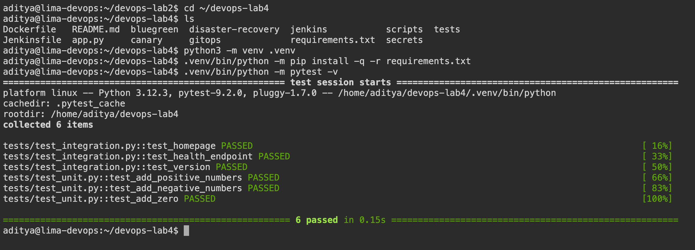

Source: [Terminal log](evidence/logs/01-local-tests-pass.txt)

### E02 - Create the GitHub repository and push

`git init`, first commit `45552cb`, then `gh repo create devops-lab4 --public --source=. --remote=origin --push` creates `Adityaporwal18/devops-lab4` on GitHub and pushes `main`.

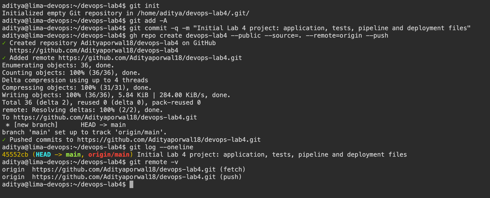

Source: [Terminal log](evidence/logs/02-create-github-repo-and-push.txt)

### E03 - Build #1 console - start

Build #1 of the Jenkins job `devops-lab4` is **Started by user Aditya Porwal** and checks out revision `45552cb` from the GitHub repository.

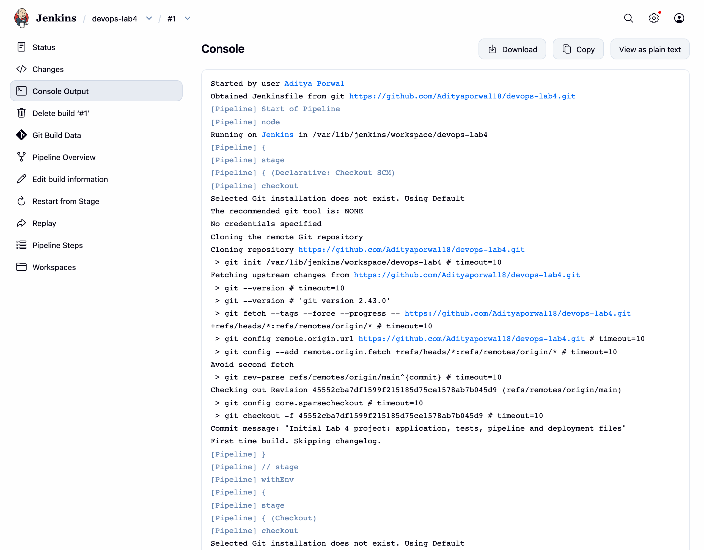

Source: [Full console log](evidence/logs/jenkins-build-1-console.txt)

### E04 - Build #1 - gate approved

Both test stages pass (3 + 3 tests), the Deployment Gate prints `All tests passed. Deployment approved.` and the build ends with **Finished: SUCCESS**.

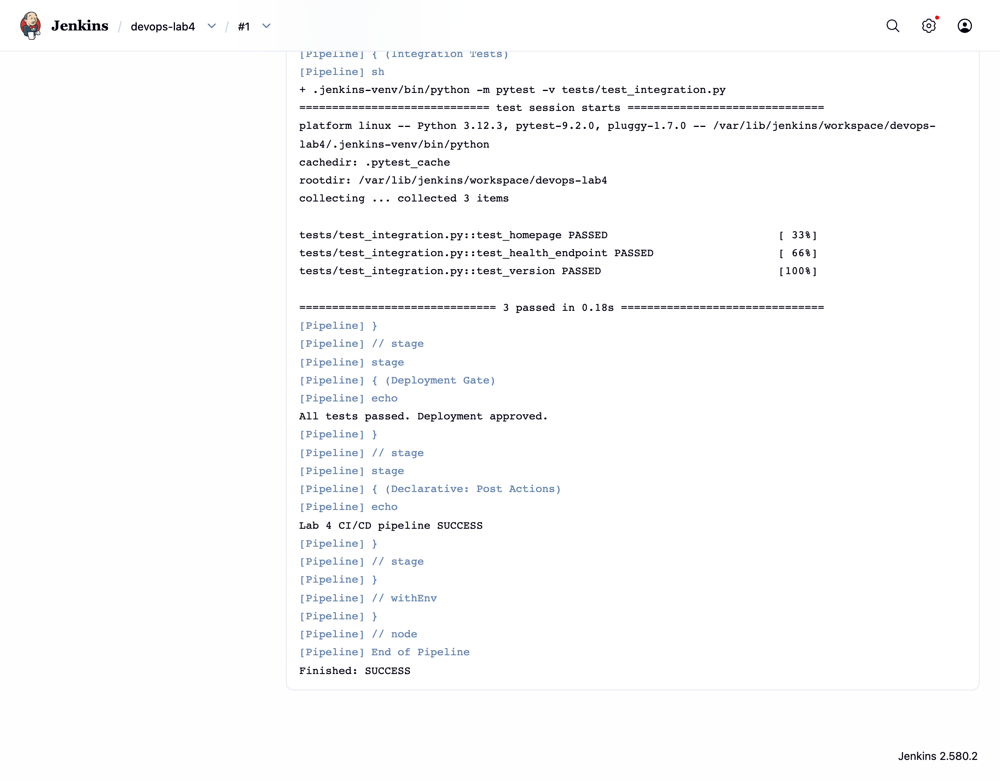

Source: [Full console log](evidence/logs/jenkins-build-1-console.txt)

### E05 - Build #1 pipeline stages

Stage view of build #1: Checkout, Install Dependencies, Unit Tests, Integration Tests, Deployment Gate and Post Actions all succeeded.

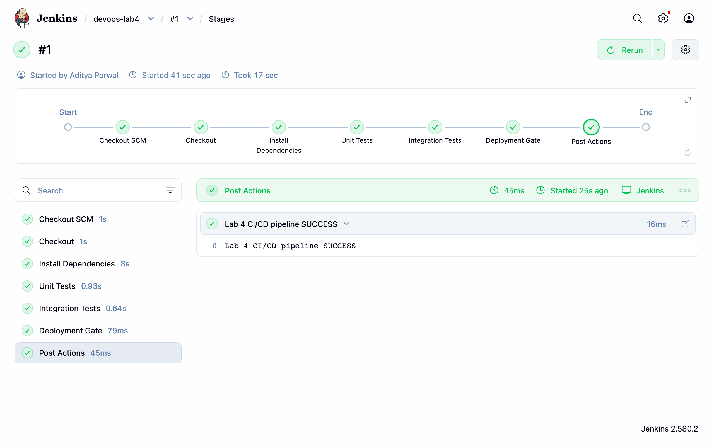

### E06 - Commit a deliberately failing test

The expected value of `add(2, 3)` is changed from 5 to 999 to exercise the failure path. The change is committed (`3feba7a`) and pushed at 14:12:11 IST.

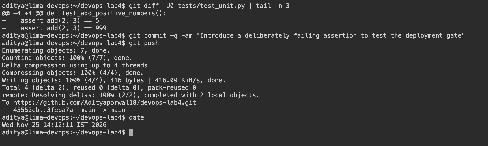

Source: [Terminal log](evidence/logs/06-commit-deliberate-failing-test.txt)

### E07 - Build #2 started by an SCM change

Polling detects the pushed commit and build #2 begins with **Started by an SCM change**.

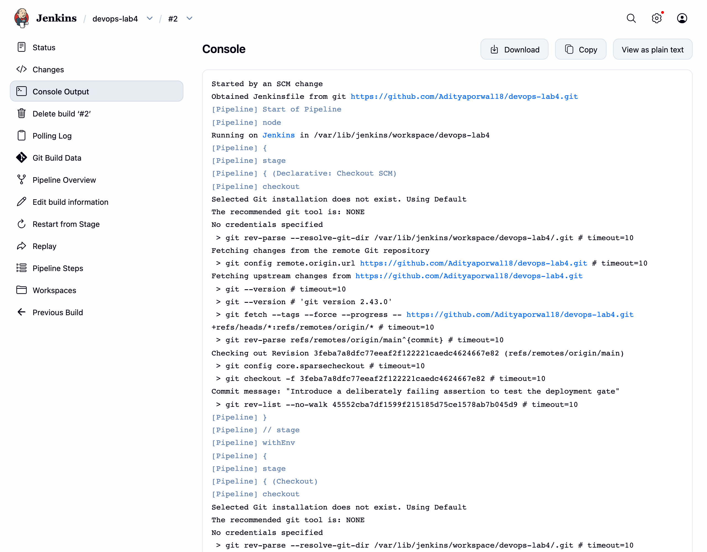

Source: [Full console log](evidence/logs/jenkins-build-2-console.txt)

### E08 - Build #2 - gate blocked

The unit test fails (`assert 5 == 999`). Jenkins reports that the stages **Integration Tests** and **Deployment Gate** are *skipped due to earlier failure(s)*, the post action prints `Tests failed. Deployment BLOCKED.` and the build ends with **Finished: FAILURE**.

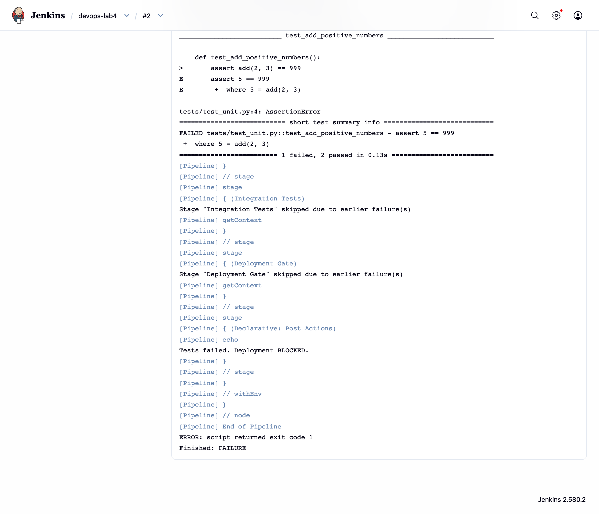

Source: [Full console log](evidence/logs/jenkins-build-2-console.txt)

### E09 - Build #2 pipeline stages

Stage view of build #2: the Unit Tests stage failed and the later stages did not run.

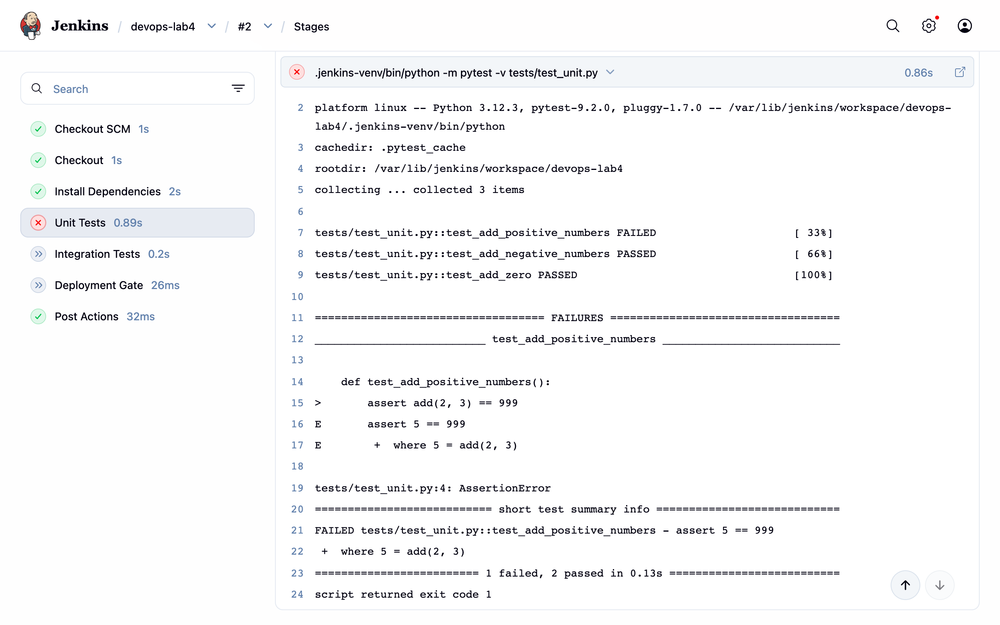

### E10 - Restore the correct assertion

The assertion is changed back to 5, committed (`177c2eb`) and pushed at 14:14:04 IST.

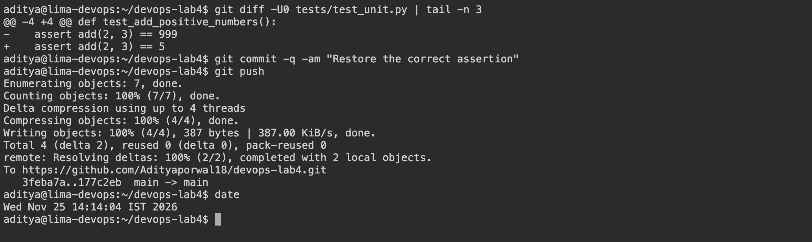

Source: [Terminal log](evidence/logs/10-commit-restored-test.txt)

### E11 - Build #3 - gate approved again

Build #3 (also started by polling) passes all six tests, the gate approves and the build ends with **Finished: SUCCESS**.

Source: [Full console log](evidence/logs/jenkins-build-3-console.txt)

### E12 - Build history: pass, fail, pass

Job page of `devops-lab4` after the three runs: #1 successful, #2 failed, #3 successful.

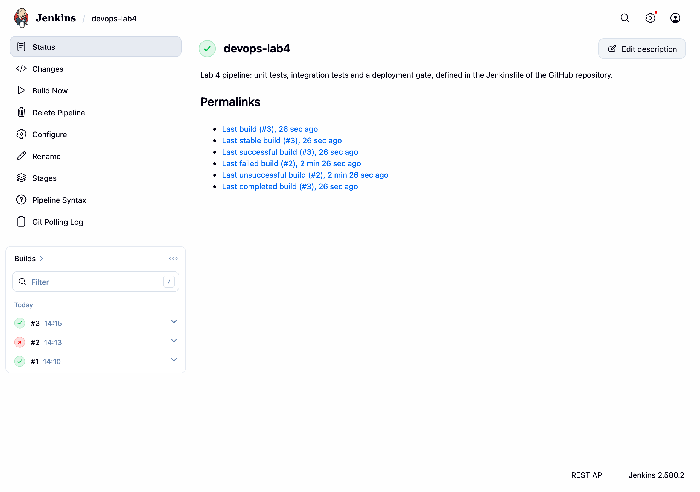

## Q2 - Blue-Green deployment

### E13 - Start Blue, Green and nginx

The nginx configuration points the upstream at `blue`. `docker compose up -d --build` builds both application images and starts Blue (v1), Green (v2) and nginx on `127.0.0.1:8086`. The public endpoint returns version `v1`.

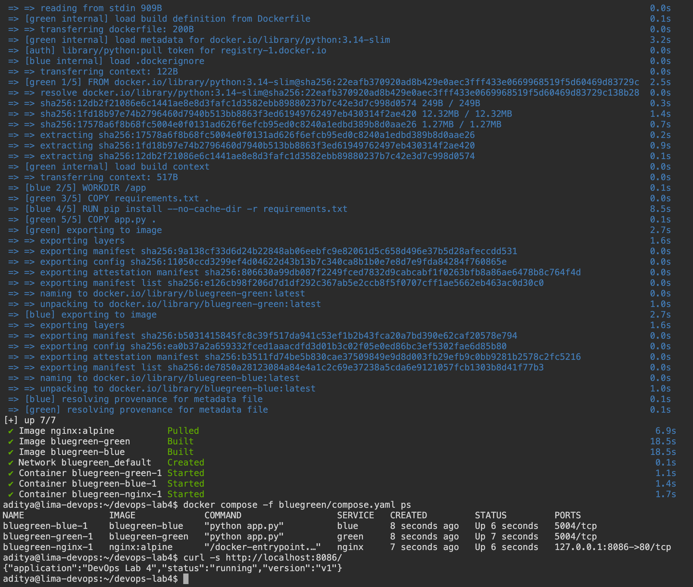

Source: [Terminal log](evidence/logs/13-bluegreen-services-start-v1.txt)

### E14 - Both versions are running

Requests made inside the containers show Blue serving `v1` and Green serving `v2`, and Green's health endpoint returns `healthy`. The public endpoint still serves `v1`, so Green can be checked before it receives traffic.

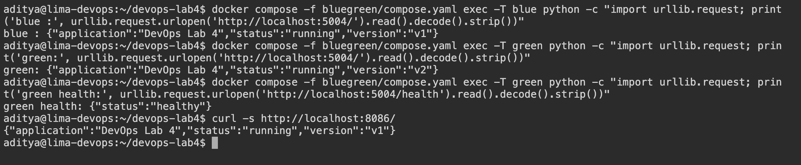

Source: [Terminal log](evidence/logs/14-bluegreen-both-versions-healthy.txt)

### E15 - First switch attempt did not take effect

First attempt to switch while requests were running: the switch script's log is empty, the configuration file already says `green`, but the endpoint still returns `v1` and 50 of 50 requests are `v1`. The file was edited, but nginx had not reloaded it.

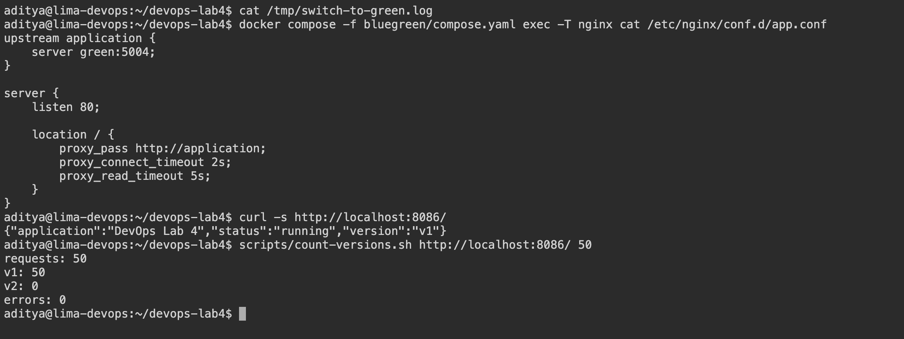

Source: [Terminal log](evidence/logs/16-bluegreen-config-edited-but-not-reloaded.txt)

### E16 - Diagnosis: the background job was stopped

`jobs -l` shows the background switch job as **Stopped (tty input)**: `docker compose exec` tried to read from the terminal, so the shell suspended the job before `nginx -s reload` ran. The stopped job was then terminated.

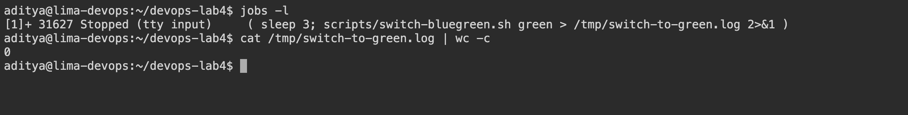

Source: [Terminal log](evidence/logs/17-bluegreen-diagnose-stopped-job.txt)

### E17 - Switch to Green under load

The script is fixed (`< /dev/null`, shown by `git diff`). While one request is sent every 0.25 s, the switch runs in the background: requests 1-9 return `v1`, requests 10-28 return `v2`, and **all 28 requests return HTTP 200**.

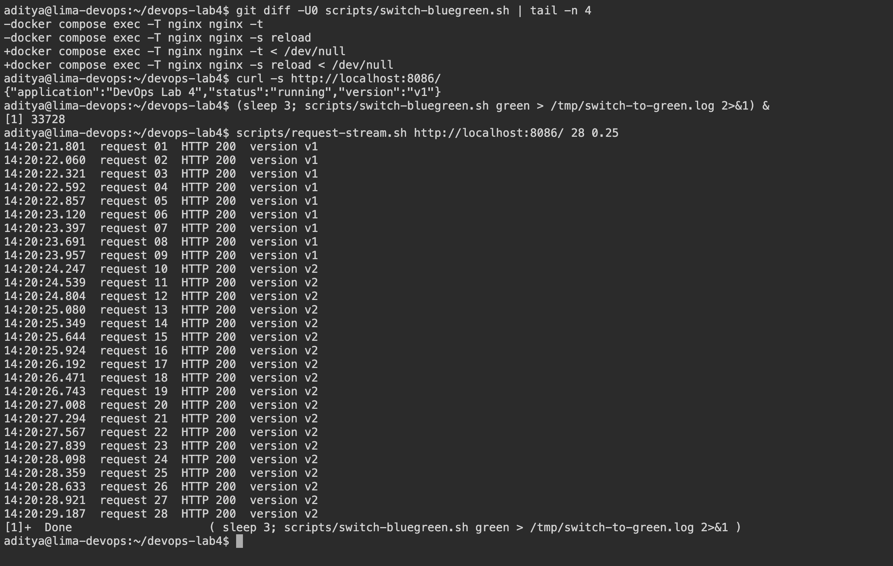

Source: [Terminal log](evidence/logs/18-bluegreen-switch-to-green-under-load.txt)

### E18 - Green is live

The switch log shows the nginx syntax test and reload. The configuration inside the running nginx container points to `green`, and 50 of 50 requests return `v2` with 0 errors.

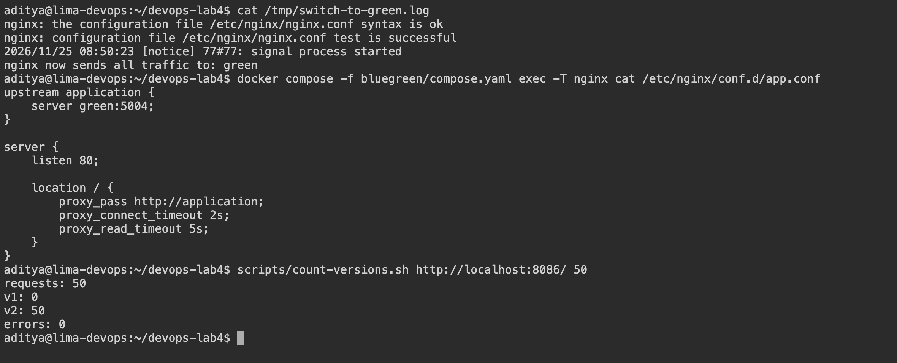

Source: [Terminal log](evidence/logs/19-bluegreen-green-live.txt)

### E19 - Version v2 in the browser

The public endpoint `http://localhost:8086/` opened in a browser returns version `v2`.

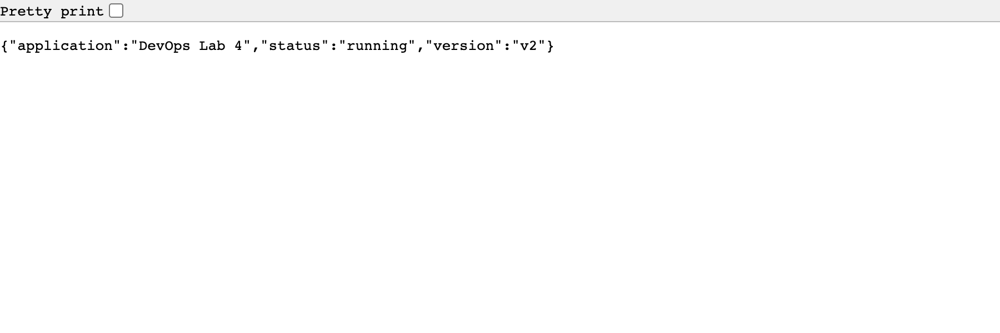

### E20 - Rollback to Blue under load

The same test in the other direction: requests 1-8 return `v2`, requests 9-28 return `v1`, all with HTTP 200.

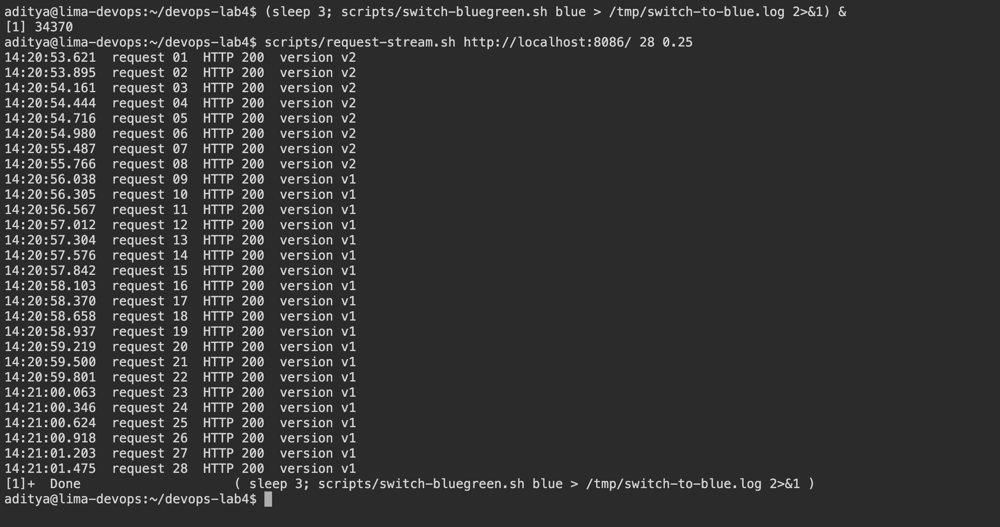

Source: [Terminal log](evidence/logs/21-bluegreen-rollback-to-blue-under-load.txt)

### E21 - Blue is live again

After the rollback 50 of 50 requests return `v1`. The script fix is committed (`44ddae7`).

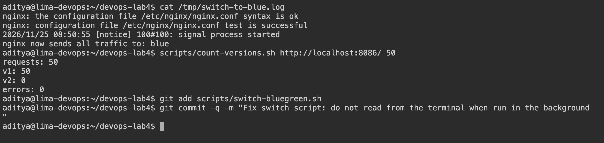

Source: [Terminal log](evidence/logs/22-bluegreen-blue-live-again.txt)

## Q3 - Canary deployment and rollback

### E22 - Start the canary stack

The canary configuration gives Blue weight 9 and Green weight 1. The stack starts with nginx on `127.0.0.1:8087`.

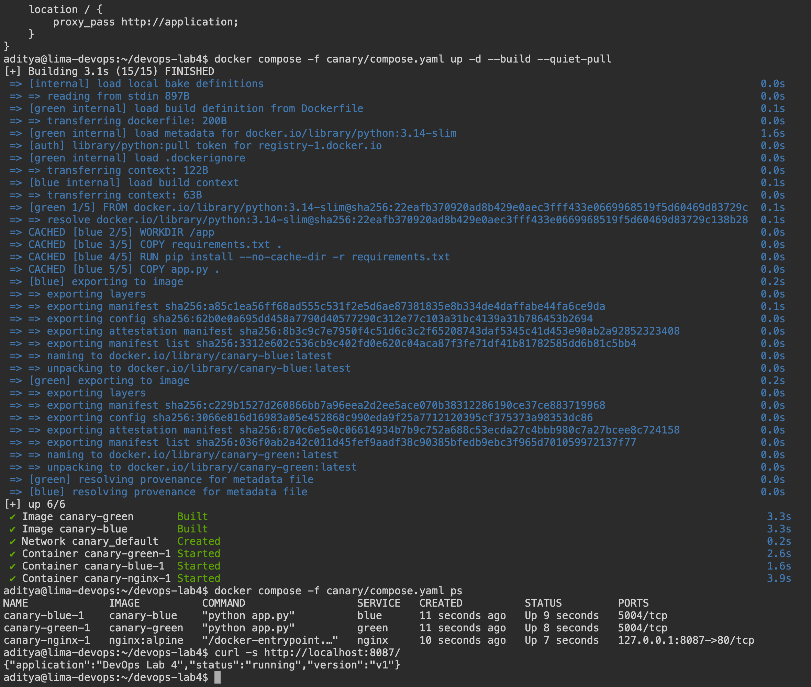

Source: [Terminal log](evidence/logs/23-canary-services-start.txt)

### E23 - 90 / 10 measured

The counting script is shown and run with 100 requests: **v1: 90, v2: 10, errors: 0**, average response time 4.5 ms.

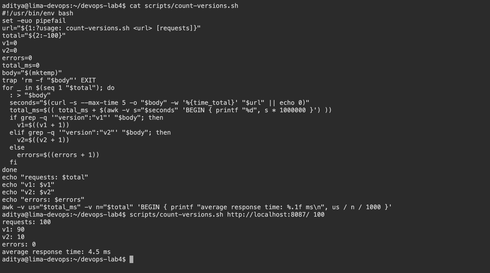

Source: [Terminal log](evidence/logs/24-canary-90-10-measured.txt)

### E24 - 70 / 30 measured

`set-canary-weights.sh 7 3` rewrites the upstream, tests and reloads nginx. The configuration inside the container shows weights 7 and 3, and 100 requests give **v1: 70, v2: 30, errors: 0**, average 5.3 ms.

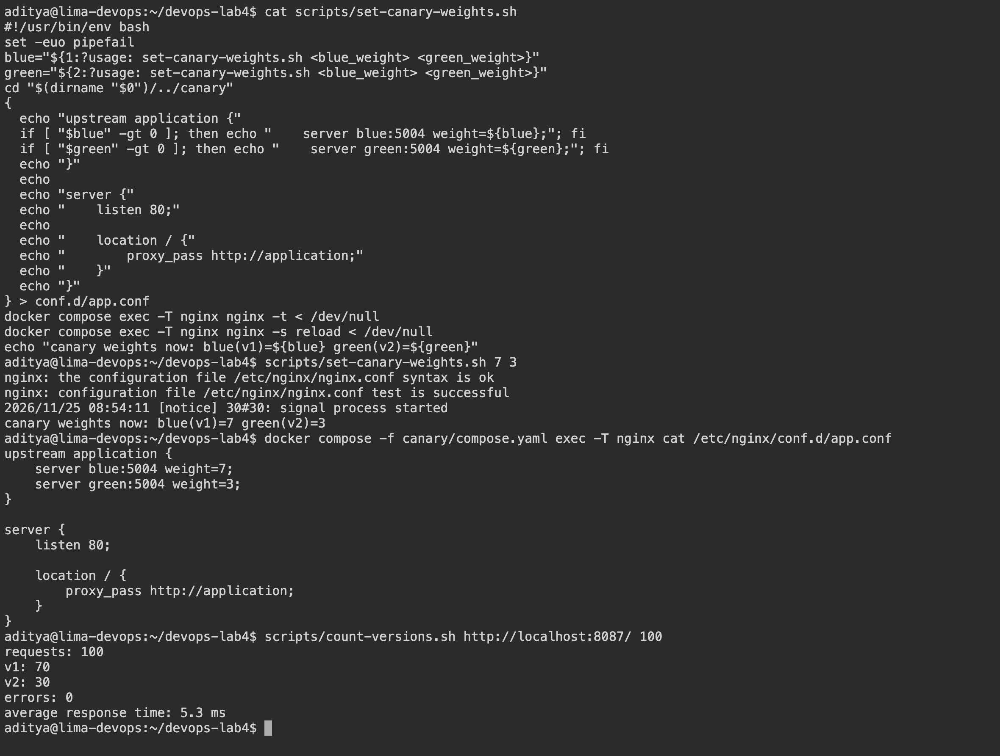

Source: [Terminal log](evidence/logs/25-canary-70-30-measured.txt)

### E25 - Rollback: all traffic to v1

`set-canary-weights.sh 1 0` removes Green from the upstream. 100 requests give **v1: 100, v2: 0, errors: 0**, average 8.5 ms.

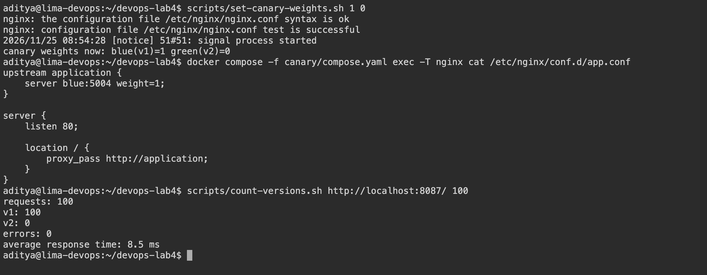

Source: [Terminal log](evidence/logs/26-canary-rollback-all-v1.txt)

### E26 - Stop the canary stack

The canary stack is removed and the rolled-back configuration is committed (`5c3f40d`).

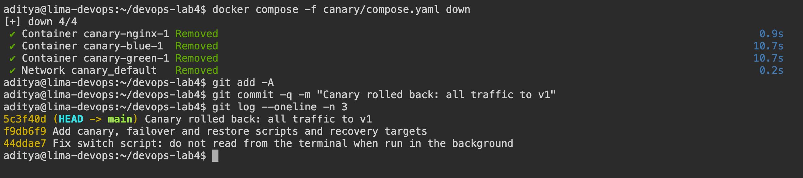

Source: [Terminal log](evidence/logs/27-canary-stopped-and-committed.txt)

## Q4 - GitOps using Argo CD

### E27 - Install Argo CD

Argo CD is installed into the `argocd` namespace of the Minikube cluster from the official stable manifest (server-side apply). All deployments become Available and the seven Argo CD pods are Running.

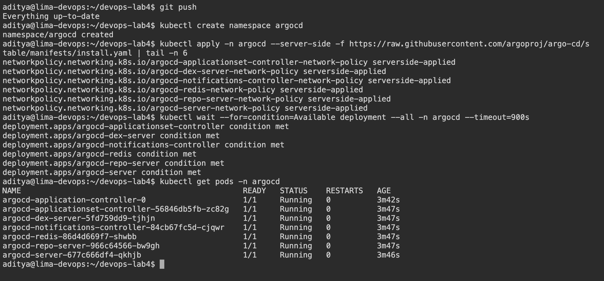

Source: [Terminal log](evidence/logs/34-argocd-install-pods-running.txt)

### E28 - Expose the Argo CD UI

`kubectl port-forward` exposes the Argo CD server on `https://localhost:8443` (HTTP 200). No applications exist yet.

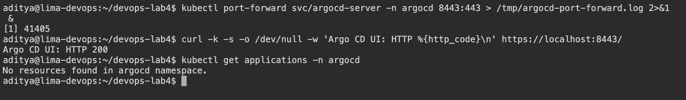

Source: [Terminal log](evidence/logs/35-argocd-port-forward.txt)

### E29 - Argo CD login page

The Argo CD web interface is reachable in the browser.

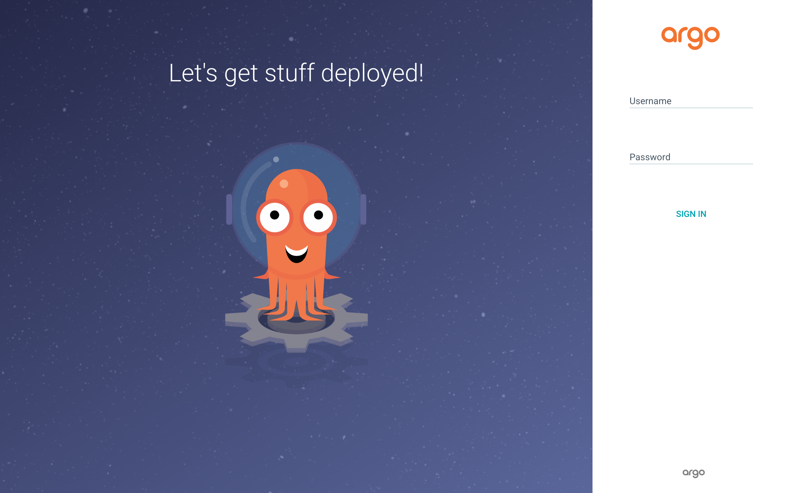

### E30 - No applications yet

The Argo CD v3.6.3 applications page before the application is created.

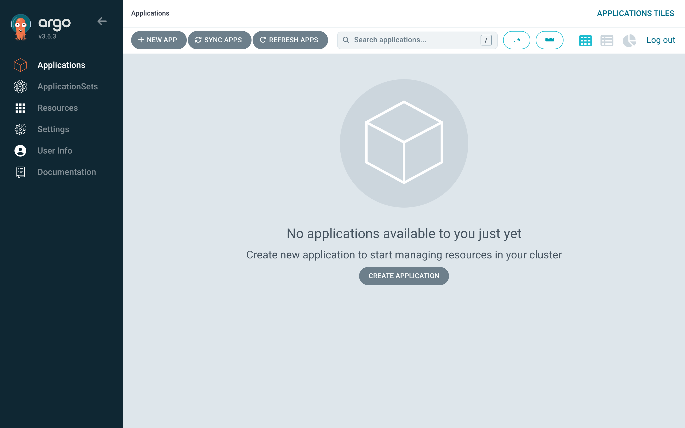

### E31 - Create the Argo CD application

`gitops/application.yaml` defines the application `gitops-demo`: repository `Adityaporwal18/devops-lab4`, revision `main`, path `gitops/manifests`, automated sync with `prune` and `selfHeal`. The Deployment manifest in Git asks for 2 replicas. The application is created with `kubectl apply` and the terminal waits until it is Healthy.

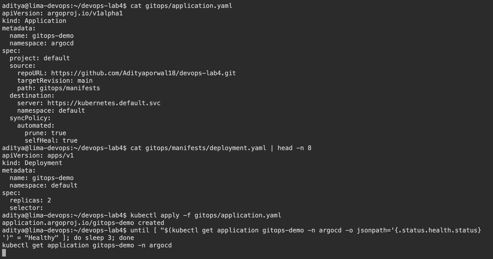

Source: [Terminal log](evidence/logs/38-argocd-application-created.txt)

### E32 - Argo CD deployed two replicas

Argo CD created the Deployment (2/2), two Running pods and the Service from Git. The application's sync policy is `{"automated":{"prune":true,"selfHeal":true}}`.

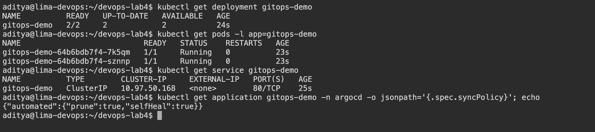

Source: [Terminal log](evidence/logs/39-gitops-initial-two-replicas.txt)

### E33 - Application Healthy and Synced

The Argo CD applications page shows `gitops-demo` as **Healthy** and **Synced**, tracking `main` at path `gitops/manifests`.

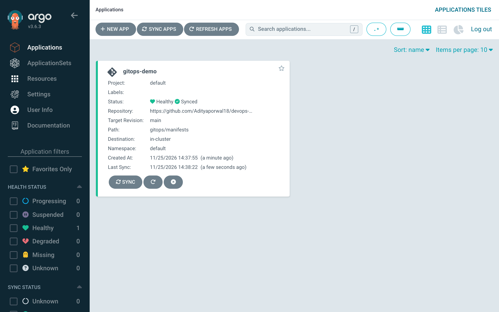

### E34 - Resource tree

The application's resource tree: Service, Deployment, ReplicaSet and two pods. The header reports *Synced to main* and *Auto sync is enabled*.

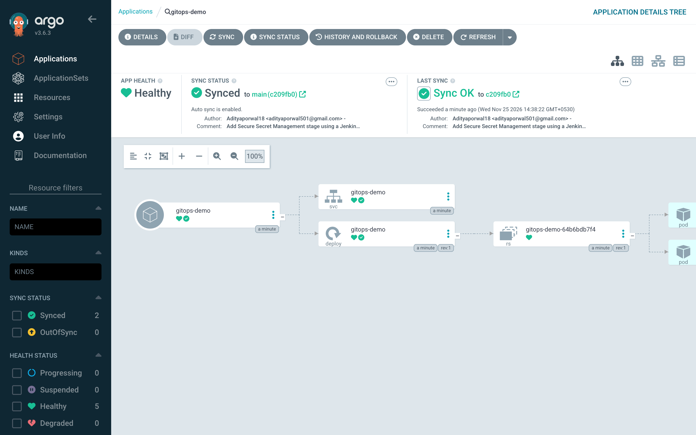

### E35 - Change the desired state in Git

`replicas` is changed from 2 to 3 in `gitops/manifests/deployment.yaml`, committed (`de1a448`) and pushed at 14:40:43 IST. The cluster still has 2/2 at that moment; no `kubectl` command changes the Deployment.

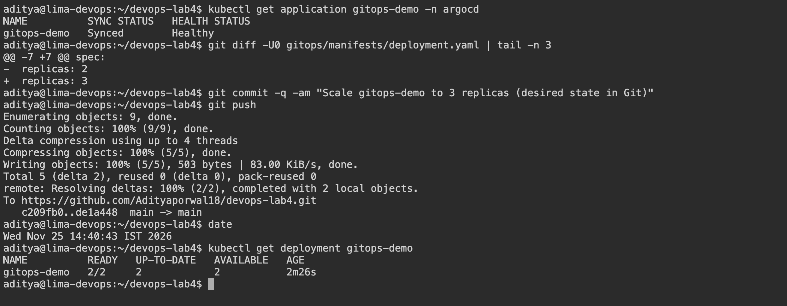

Source: [Terminal log](evidence/logs/42-gitops-commit-three-replicas.txt)

### E36 - Argo CD applies the commit

The terminal only waits. By 14:43:01 the Deployment is 3/3 with a third pod 12 seconds old. Argo CD reports `Synced Healthy` at revision `de1a448`, which equals `git rev-parse HEAD`.

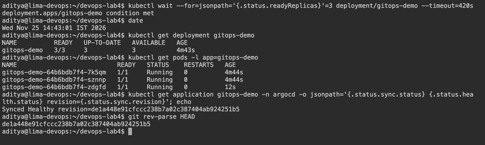

Source: [Terminal log](evidence/logs/43-gitops-argocd-synced-three-replicas.txt)

### E37 - Resource tree with three pods

Argo CD's resource tree after the sync: three pods, Healthy and Synced to `main (de1a448)`.

### E38 - Self-heal after a manual change

The Deployment is scaled to 1 by hand at 14:44:04. The loop prints the state every two seconds: 1/1 at 14:44:07, and **3/3 again at 14:44:13** without any further command. Argo CD still reports `Synced Healthy` and Git still says `replicas: 3`.

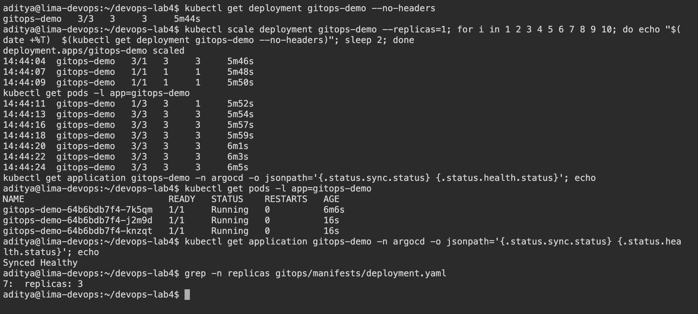

Source: [Terminal log](evidence/logs/45-gitops-self-heal-after-manual-drift.txt)

### E39 - Kubernetes events and Argo CD history

The Deployment's events record all four changes: 0 to 2 (first sync), 2 to 3 (Git commit), 3 to 1 (manual change) and 1 to 3 (self-heal). Argo CD's history lists the two synced Git revisions `c209fb0` and `de1a448`.

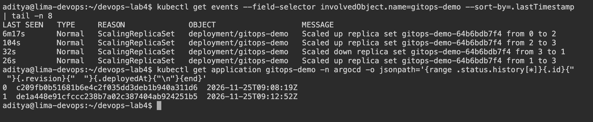

Source: [Terminal log](evidence/logs/46-gitops-scaling-events-and-sync-history.txt)

### E40 - Resource tree after self-heal

After the self-heal the application is again Healthy and Synced with three pods.

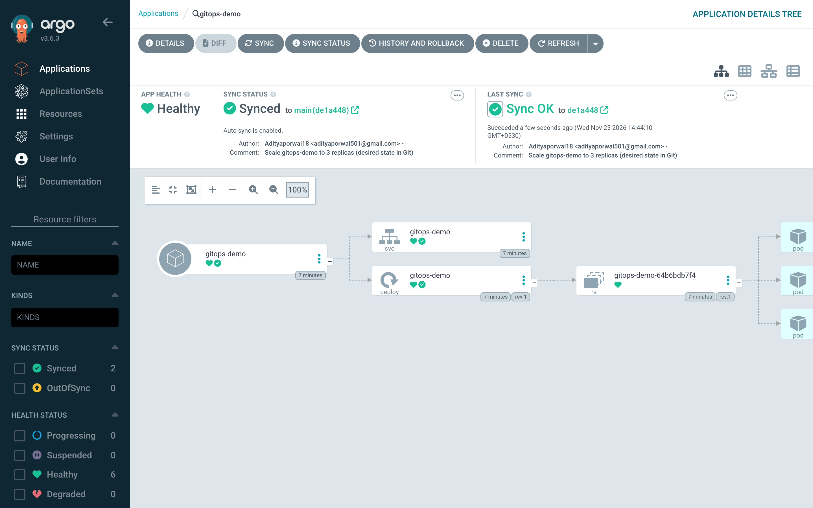

## Q5 - Secure secret management

### E41 - Jenkins credential

The Jenkins credential store contains a *Secret text* credential with ID `lab4-api-key`. Jenkins does not display its value. The value is a randomly generated demo string that is not stored in this repository.

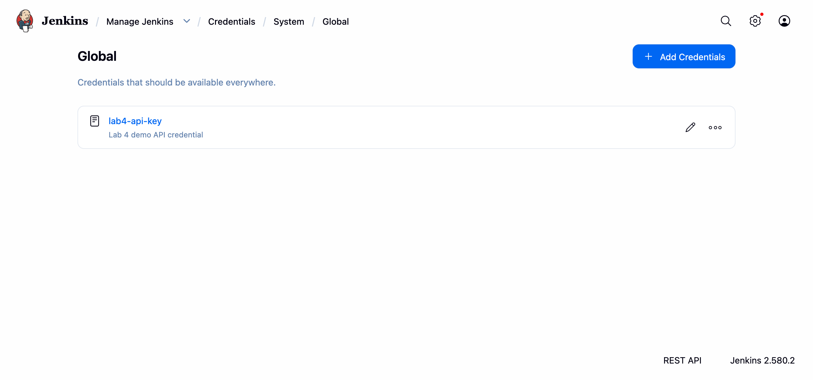

### E42 - Add the secret stage to the pipeline

A stage **Secure Secret Management** is added to the Jenkinsfile. It loads the credential with `withCredentials` and, on purpose, tries to print it. The change is committed (`c209fb0`) and pushed at 14:27:07 IST.

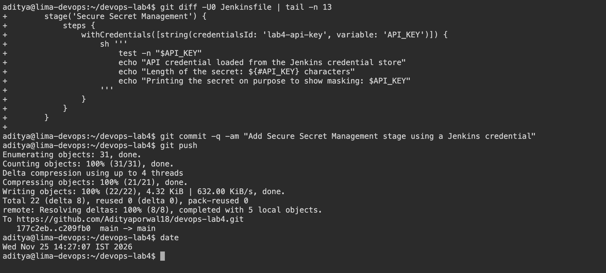

Source: [Terminal log](evidence/logs/29-commit-secret-stage.txt)

### E43 - Build #4 - secret is masked

Console of build #4: `Masking supported pattern matches of $API_KEY`, the secret has 29 characters, and the line that prints the secret shows `****` instead of the value.

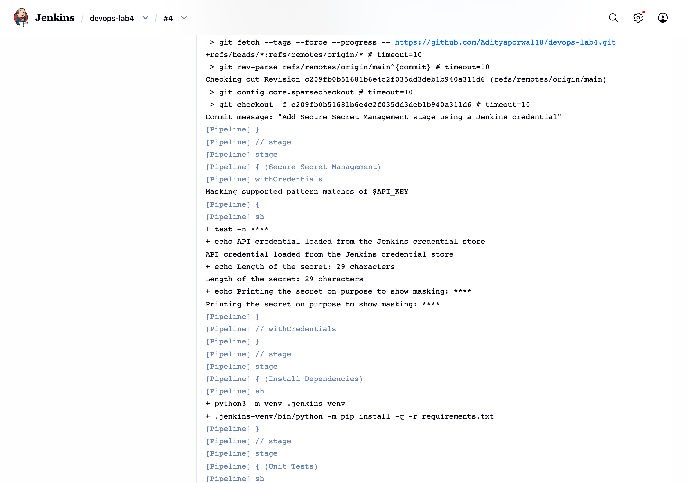

Source: [Full console log](evidence/logs/jenkins-build-4-console.txt)

### E44 - Build #4 pipeline stages

Stage view of build #4 including the Secure Secret Management stage; all stages succeeded.

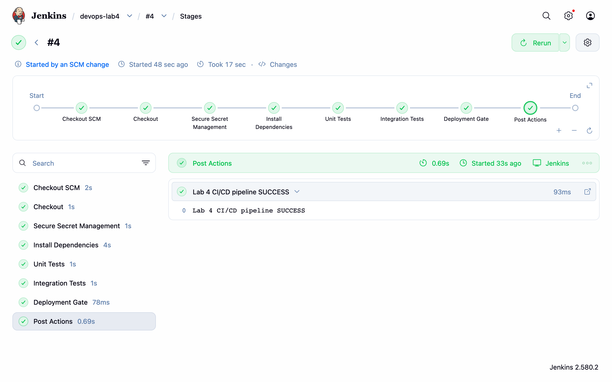

### E45 - Create a Kubernetes Secret

A Secret `lab4-app-secret` is created from a random value generated on the command line. `kubectl describe` shows only the key name and size (32 bytes). The Pod manifest reads the key through `secretKeyRef`.

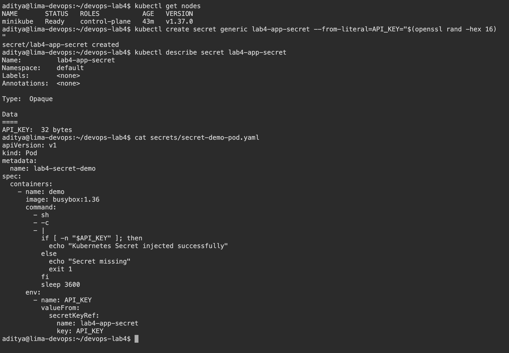

Source: [Terminal log](evidence/logs/32-kubernetes-secret-created.txt)

### E46 - Secret injected into a Pod

The Pod `lab4-secret-demo` becomes Ready and logs `Kubernetes Secret injected successfully`. Inside the container the variable has 32 characters; the value itself is never printed.

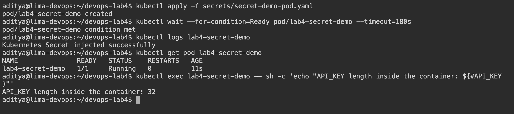

Source: [Terminal log](evidence/logs/33-kubernetes-secret-injected.txt)

## Q6 - Disaster recovery and failover

### E47 - Recovery targets defined first

`disaster-recovery/TARGETS.md` states the RTO and RPO targets. `git log` shows the file was committed (`f9db6f9`) before the recovery tests below were run.

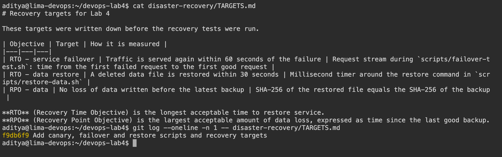

Source: [Terminal log](evidence/logs/48-recovery-targets-defined-first.txt)

### E48 - Persistent volume and original data

A PersistentVolumeClaim (100Mi, Bound) and a Pod are created. A test record is written to `/data/record.txt` and its SHA-256 checksum is printed.

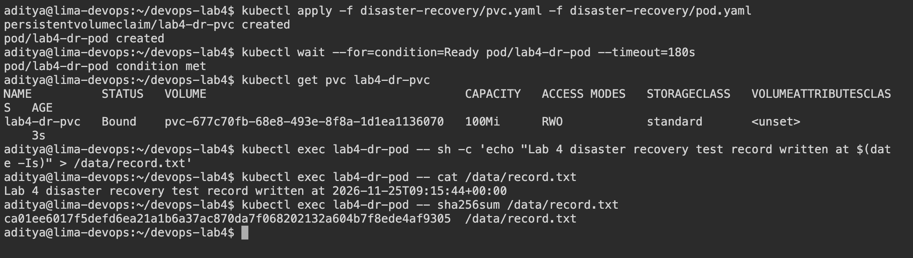

Source: [Terminal log](evidence/logs/49-dr-pvc-and-original-data.txt)

### E49 - Backup and checksum

`kubectl cp` copies the file out of the Pod as a backup. The backup has the same SHA-256 checksum as the original.

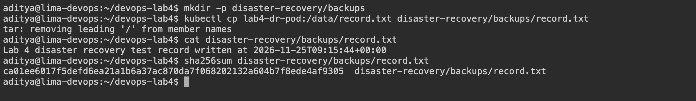

Source: [Terminal log](evidence/logs/50-dr-backup-and-checksum.txt)

### E50 - Delete and timed restore

The file is deleted (`No such file or directory`). `restore-data.sh` copies the backup back, measures the time in milliseconds and compares checksums: **restore took 379 ms** and the checksums match.

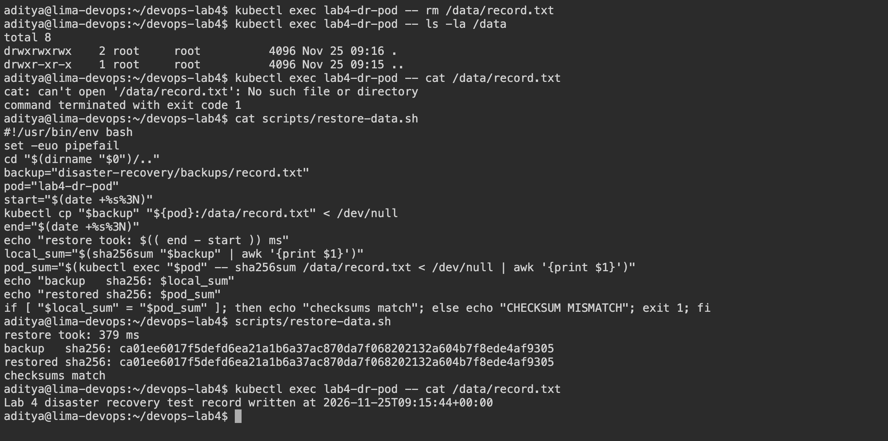

Source: [Terminal log](evidence/logs/51-dr-delete-and-timed-restore.txt)

### E51 - Data survives Pod recreation

The Pod is deleted and created again. The record and its checksum are unchanged, because the data lives on the persistent volume.

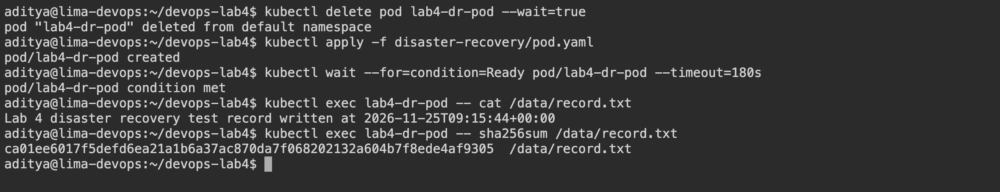

Source: [Terminal log](evidence/logs/52-dr-data-survives-pod-recreation.txt)

### E52 - Failover test: starting state and script

Before the test Blue, Green and nginx are running and the endpoint serves `v1`. The failover script starts a request stream, kills Blue, waits 5 seconds as a simulated detection time, switches nginx to Green and summarises the outage.

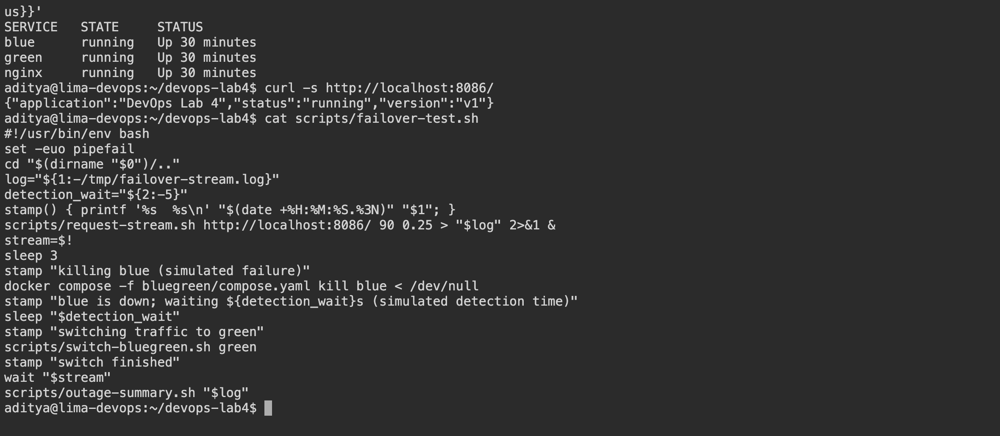

Source: [Terminal log](evidence/logs/53-failover-before-and-script.txt)

### E53 - Failover test run

Blue is killed at 14:47:34.6 and traffic is switched to Green at 14:47:40.5. The request stream shows 12 good `v1` responses, then one HTTP 502 and three HTTP 504, then 74 good `v2` responses. **Measured outage: 7335 ms** (first failed request 14:47:35.101, first good request 14:47:42.436).

Source: [Terminal log](evidence/logs/54-failover-test-run.txt) | [Complete request stream (90 requests)](evidence/logs/failover-request-stream.txt)

### E54 - Request stream during the failover

Requests 8-40 of the stream: the last `v1` responses, the four failed requests (502, 504, 504, 504) and the first `v2` responses.

Source: [Terminal log](evidence/logs/55-failover-request-stream.txt) | [Complete request stream (90 requests)](evidence/logs/failover-request-stream.txt)

### E55 - Green serves all traffic

After the failover Blue is `exited (137)`, Green and nginx are running, nginx points to `green`, and 50 of 50 requests return `v2`.

Source: [Terminal log](evidence/logs/56-failover-green-serving.txt)

### E56 - Blue repaired as standby

Blue is started again and is healthy. Traffic stays on Green (`v2`); Blue is now the standby environment.

Source: [Terminal log](evidence/logs/57-failover-blue-repaired-standby.txt)

## Q7 - Report and repository

### E57 - Commit and push the lab work

The remaining changes are committed (`51515d9`) and pushed. The log lists the commits made during the lab.

Source: [Terminal log](evidence/logs/58-commit-and-push-lab-work.txt)

### E58 - Jenkins build history

Job page of `devops-lab4` with builds #1 to #6. Only #2, the deliberate failure, is red; every other push was tested and approved automatically.

### E59 - Commit and push the documentation

The report, evidence gallery, command record and screenshots are committed and pushed to GitHub.

Source: [Terminal log](evidence/logs/60-commit-and-push-documentation.txt)

### E60 - Final repository on GitHub

The repository `Adityaporwal18/devops-lab4` on GitHub with the application, tests, pipeline, deployment files, report and the `docs` folder.

